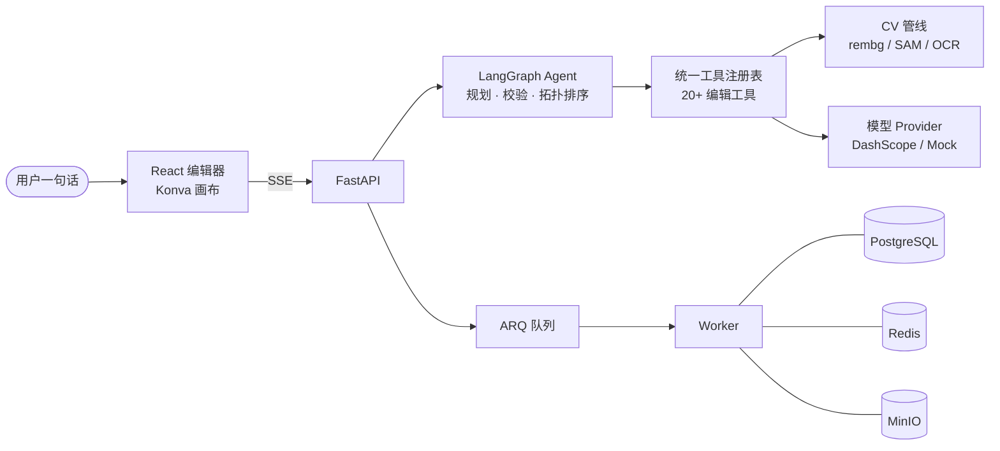

<div align="center">

# AI 修图工作台

**一句话驱动的 AI 修图工作台：Agent 自动规划修图步骤，调度 20+ 编辑工具完成专业级修图。**

自然语言修图 · SAM 区域选择 · 图层拆分 · AI 文生图 · 局部编辑

[](https://www.typescriptlang.org)
[](https://react.dev)
[](https://konvajs.org)
[](https://tailwindcss.com)
[](https://tanstack.com/query)
[](https://zustand.docs.pmnd.rs)
[](https://pnpm.io)
[](https://vite.dev)

[](https://www.python.org)
[](https://fastapi.tiangolo.com)
[](https://www.langchain.com/langgraph)
[](https://www.sqlalchemy.org)
[](https://www.postgresql.org)
[](https://redis.io)
[](https://min.io)
[](https://docs.astral.sh/uv/)
[](https://www.docker.com)

</div>

---

基于 FastAPI + LangGraph 与 React 19 + Konva 的全栈修图应用。用户输入一句自然语言，Agent 自动分析需求、规划修图步骤，然后逐步调用编辑工具执行——抠图、调色、区域编辑、图层拆分全部自动完成。前端提供支持缩放平移、图层文档、撤销重做的专业画布编辑器，所有长任务通过 ARQ 队列异步执行，Redis Pub/Sub + SSE 实时推送进度。

## ✨ 特性

| 能力            | 说明                                                                                                           |
| --------------- | -------------------------------------------------------------------------------------------------------------- |
| 🤖 自然语言修图 | 「把背景换成海滩」，Agent 规划步骤后逐步调用工具，UI 与 Agent 共用同一套工具注册表                             |
| 🗺️ 多步计划     | 复杂需求生成结构化 JSON 计划，服务端校验参数、补全依赖、环检测，按拓扑排序执行，支持确认 / 单步重试 / 取消后续 |
| 🎨 画布编辑器   | react-konva 实现：缩放平移、图层文档、撤销重做、前后对比滑杆                                                   |
| 🎯 智能选区     | SAM 点选 + 笔刷涂抹，首次点击缓存 embedding，后续点选毫秒级响应；支持局部消除与局部替换（AI Inpainting）       |
| 🧩 图层拆分     | 一键拆分主体 / 背景 / OCR 文字层，各层独立缩放、调色、移动，JSONB 持久化                                       |
| 🖼️ AI 文生图    | 提示词生成四宫格候选图，SSE 实时进度，选中即进编辑器                                                           |
| 📦 批量处理     | ARQ 异步队列 + 批量像素处理，进度推送、打包下载                                                                |

## 🖼️ 功能预览

### 自然语言修图

在对话框输入一句话，Agent 自动规划步骤并调用工具执行，无需找按钮、调参数：


### 专业画布编辑器

画布缩放平移、图层文档管理、撤销重做，前后对比滑杆一拖即见修图效果：


### 智能区域选择与局部编辑

SAM 点选精准选中任意物体，配合局部消除（Inpainting 抹除并补全背景）与局部替换（只改选区内容）：


### 图层拆分

一键按语义拆出主体 / 背景 / OCR 文字层，各图层独立编辑互不影响，切换图片后图层结构不丢：


### 多步计划与人机协作

复杂需求输出带依赖关系的结构化计划，用户确认执行、单步重试或取消后续，AI 干活你把关：


## 🏗️ 架构总览



几个关键设计：

- **统一工具注册表**：所有编辑工具一处定义，UI 工具栏与 Agent 共用，保证人手操作和 AI 调用行为一致
- **Provider 抽象层**：生图 / 编辑 / 规划模型通过配置切换，`mock` 本地占位零费用调试，`dashscope` 一键接真实模型
- **计划服务端校验**：Agent 输出的计划经过工具存在性、参数合法性、依赖补全与环检测，再按拓扑排序执行
- **实时进度**：长任务走 ARQ 队列，Redis Pub/Sub 广播事件，SSE 推送到前端做进度插值

## 🚀 快速开始

### 1. 配置

```bash
cp .env.example .env
```

### 2. 启动基础设施

```bash
docker compose up -d postgres redis minio
```

### 3. 启动后端

```bash
cd backend
uv sync --all-extras                 # 安装依赖（含 cv / agent 可选组）
uv run alembic upgrade head          # 初始化数据库
uv run python -m app                 # API :7302
uv run arq app.worker.WorkerSettings # 另开终端启动 Worker
```

### 4. 启动前端

```bash
cd client
pnpm install
pnpm dev
```

### 一键部署

```bash
docker compose --profile deploy up -d
```

多阶段构建，前端产物由后端同源托管，访问 `http://localhost:7302` 即可。

## ⚙️ 配置说明

核心配置在 `.env`：

| 变量                                                         | 说明                                                                                |
| ------------------------------------------------------------ | ----------------------------------------------------------------------------------- |
| `IMAGE_PROVIDER`                                             | `mock` 使用本地占位图（零费用）；`dashscope` 接入真实模型，需填 `DASHSCOPE_API_KEY` |
| `TEXT_TO_IMAGE_MODEL` / `IMAGE_EDIT_MODEL` / `PLANNER_MODEL` | 生图、编辑、规划模型名，按业务空间调整                                              |
| `MATTING_PROVIDER`                                           | 抠图服务：`auto` 优先 rembg，`corner` 仅四角抠图                                    |
| `OCR_PROVIDER`                                               | `auto` 检测到 RapidOCR 时拆出文字层，`none` 跳过                                    |
| `DATABASE_URL` / `REDIS_URL` / `S3_*`                        | PostgreSQL、Redis、MinIO 连接配置                                                   |
| `JWT_SECRET` / `JWT_TTL_HOURS`                               | 登录态签名密钥与有效期，生产环境必须替换随机值                                      |

## 🗂️ 项目结构

```text
backend/app/
  agent/       LangGraph Agent：规划、图编排、LLM 接入
  edits/       图像编辑管线：抠图、OCR、分割、渲染、像素处理
  tools/       统一工具注册表（UI 与 Agent 共用）
  providers/   模型抽象层：Mock / DashScope 可切换
  routers/     REST API：认证、会话、资产、批次、事件
  worker.py    ARQ 异步任务 Worker
  eval/        评测脚本与数据集

client/src/
  pages/       落地页、登录、创作（文生图）、候选图、编辑器、批量处理
  components/
    editor/    画布舞台、编辑工具栏、Agent 对话框、图层面板、
               选区覆盖层、图片墙、会话侧边栏
    landing/   落地页展示组件
  hooks/       画布视口、选区笔刷、运行进度平滑、批量任务等业务 Hook
  stores/      Zustand 状态：画布视口、编辑器 UI、全局提示
  lib/         图层 / 选区 / 笔刷 / 调色预览等纯逻辑工具
  api/         按模块划分的接口层（认证、会话、资产、Agent、批次）

docker-compose.yml   基础设施 + deploy profile
Dockerfile           多阶段构建：前端构建 → 后端同源托管
```

## 许可证

[MIT](LICENSE)
